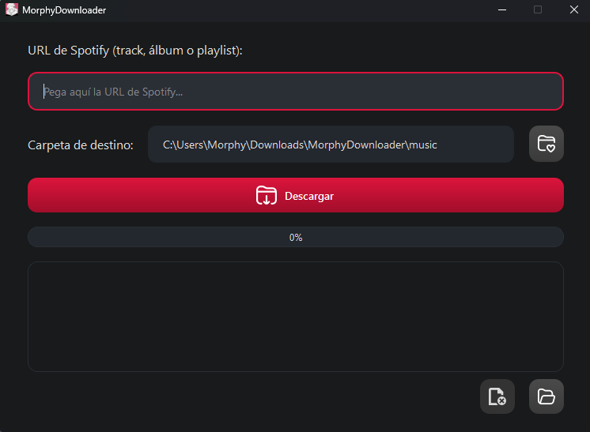
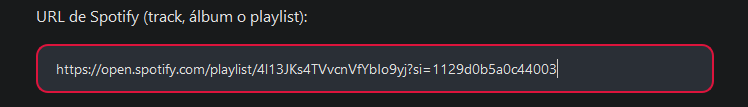

# Harmony

Harmony is a desktop and command-line music downloader for YouTube, SoundCloud, and Spotify links or direct song search queries. It can process Spotify tracks/playlists (optional credentials), YouTube videos/playlists, SoundCloud tracks/sets, or direct text search terms, download high-quality M4A or MP3 audio, and write metadata such as title, artist, album, track number, release date, cover art, and optional lyrics.



## Features

- Modern minimalist user interface with animated progress bars and dynamic platform badges.
- Download directly from YouTube (videos and playlists).
- Download directly from SoundCloud (tracks and sets/playlists).
- Direct search query support (type any song or artist name to search and download directly).
- Optional Spotify support for tracks, albums, and playlists (credentials only needed for Spotify links).
- Save audio as M4A without conversion, or MP3 when FFmpeg is available.
- Embed rich ID3/MP4 metadata, album cover art, and optional lyrics using `mutagen` and `lrclib`.
- Optional file naming templates and subfolders for albums/playlists.
- Configurable parallel downloads.
- Modern GUI built with PySide6 and a CLI built with Typer/Rich.

## How It Works

Harmony has two download flows:

1. **Spotify URL**
   - Reads track, album, or playlist metadata through the Spotify Web API.
   - Builds optimized YouTube search queries for every track.
   - Selects the best matching YouTube result with title, artist, channel, and duration checks.
   - Downloads the audio with `yt-dlp`.
   - Applies Spotify metadata and cover art.

2. **YouTube URL**
   - Detects whether the URL points to a video or playlist.
   - Reads available metadata directly with `yt-dlp`.
   - Downloads each video as audio.
   - Applies YouTube-derived metadata and thumbnail art when available.



## Supported Inputs

- Direct Song Title or Artist Search (e.g. `Daft Punk One More Time`)
- SoundCloud Tracks (`https://soundcloud.com/...`) and Sets (`https://soundcloud.com/.../sets/...`)
- YouTube Videos (`https://www.youtube.com/watch?v=...`) and Playlists (`https://www.youtube.com/playlist?list=...`)
- Spotify Tracks, Albums, and Playlists (`https://open.spotify.com/...`)
- YouTube Music & Short links supported by `yt-dlp`

If a YouTube video URL also contains a `list=` parameter, Harmony treats it as a playlist URL.

## Requirements

- Python 3.12 or newer
- Spotify Developer credentials for Spotify downloads
- FFmpeg only if you want MP3 output

Install the Python dependencies:

```sh
pip install -r requirements.txt
```

Main dependencies:

- `yt-dlp`
- `spotipy`
- `mutagen`
- `PySide6`
- `typer`
- `rich`
- `certifi`

## Pre-Built Executable

Windows builds can be published from the GitHub Releases page as a ZIP file. Users only need to extract the ZIP and run `Harmony.exe`; Python is not required for the packaged version.


## Spotify Setup

Spotify credentials are not needed for YouTube downloads, but they are required for Spotify tracks, albums, and playlists.

1. Open the [Spotify Developer Dashboard](https://developer.spotify.com/dashboard/).
2. Create an app.
3. Copy the `Client ID` and `Client Secret`.
4. Add them in Harmony's configuration window, or set them manually:

```sh
set SPOTIPY_CLIENT_ID=your_client_id
set SPOTIPY_CLIENT_SECRET=your_client_secret
```

PowerShell:

```powershell
$env:SPOTIPY_CLIENT_ID="your_client_id"
$env:SPOTIPY_CLIENT_SECRET="your_client_secret"
```

## Usage

### GUI

Start the desktop app:

```sh
python main.py
```

Paste a Spotify or YouTube URL, choose the output folder, select the audio format, and start the download. Settings such as format, quality, naming template, subfolders, theme, language, lyrics, and parallel downloads can be changed from the configuration button.

### CLI

Spotify playlist example:

```sh
python -m m4a_downloader.cli --url "https://open.spotify.com/playlist/PLAYLIST_ID" --output music
```

YouTube video example:

```sh
python -m m4a_downloader.cli --url "https://www.youtube.com/watch?v=VIDEO_ID" --output music
```

YouTube playlist example:

```sh
python -m m4a_downloader.cli --url "https://www.youtube.com/playlist?list=PLAYLIST_ID" --output music
```

Useful options:

- `--url`, `-u`: Spotify or YouTube URL.
- `--output`: Output folder. Defaults to `music`.
- `--format`, `-f`: `m4a` or `mp3`.
- `--quality`, `-q`: MP3 bitrate, such as `128`, `192`, `256`, or `320`.
- `--parallel`, `-p`: Number of parallel downloads, from `1` to `8`.

## Building the Windows App

The main GUI build uses `Harmony.spec`.

```powershell
pyinstaller --clean --noconfirm Harmony.spec
```

The output is created in:

```text
dist/Harmony/
```

To create a release ZIP:

```powershell
Compress-Archive -Path .\dist\Harmony\* -DestinationPath .\dist\Harmony-windows.zip -Force
```

## Project Structure

```text
.
├── main.py
├── m4a_downloader/
│   ├── cli.py
│   ├── config.py
│   ├── locales.py
│   ├── utils.py
│   ├── core/
│   │   ├── metadata.py
│   │   ├── spotify_client.py
│   │   └── youtube_downloader.py
│   └── gui/
│       ├── config_dialog.py
│       ├── qt_gui.py
│       └── theme_manager.py
├── assets/
├── docs/
├── Harmony.spec
├── m4a_downloader.spec
└── requirements.txt
```

## Notes

- M4A is the default format because it can be downloaded directly from YouTube without conversion.
- MP3 output requires FFmpeg. If FFmpeg is unavailable, Harmony falls back to M4A.
- YouTube extraction depends on `yt-dlp`; keeping it updated helps when YouTube changes its site behavior.
- Download only content you own, content in the public domain, or content you have permission to download.

## License

MIT License.

## Español

For the Spanish version, see [README_ES.md](README_ES.md).
